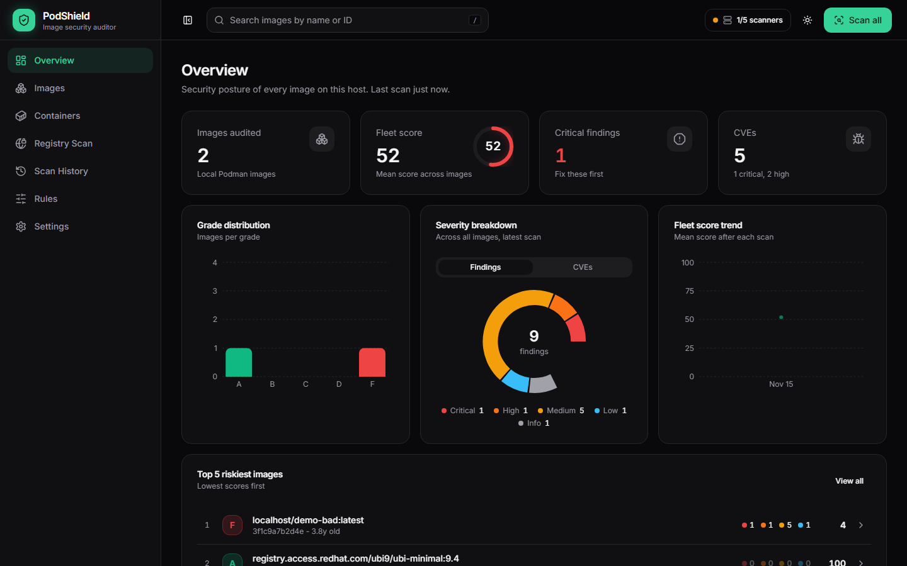
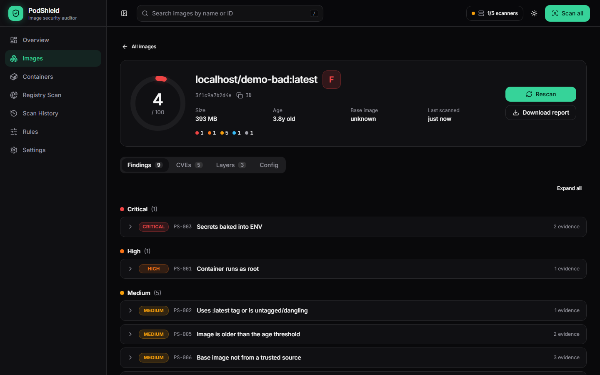
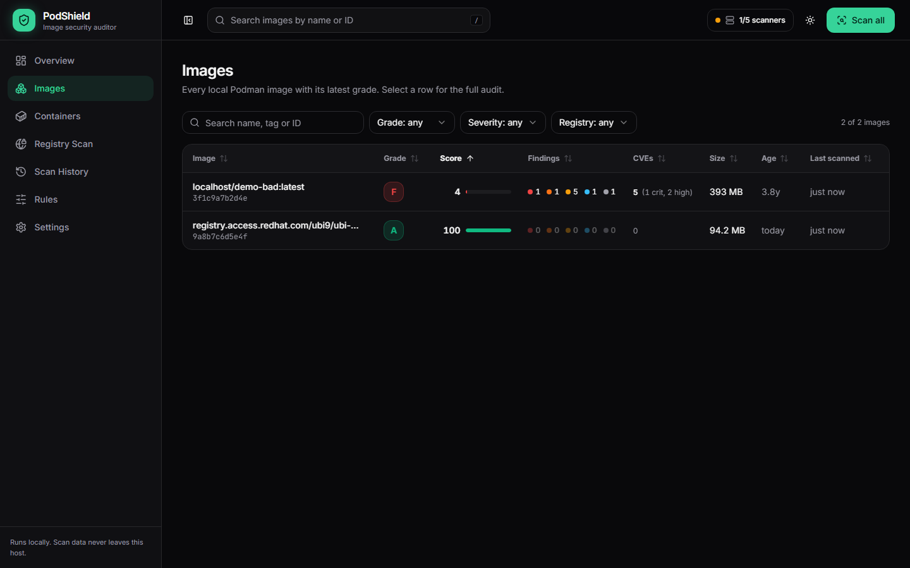
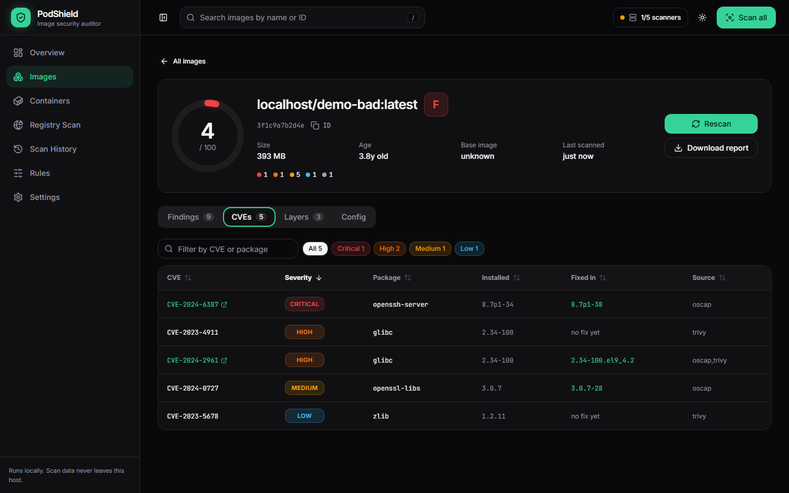
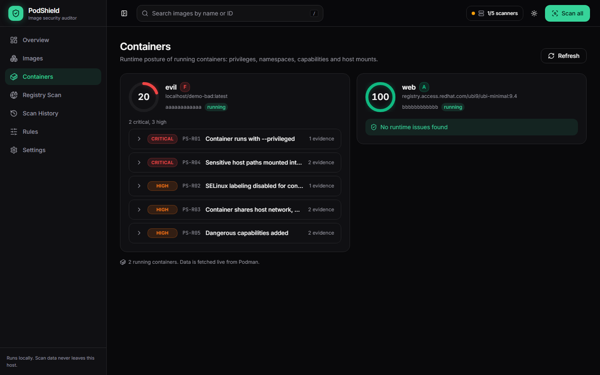
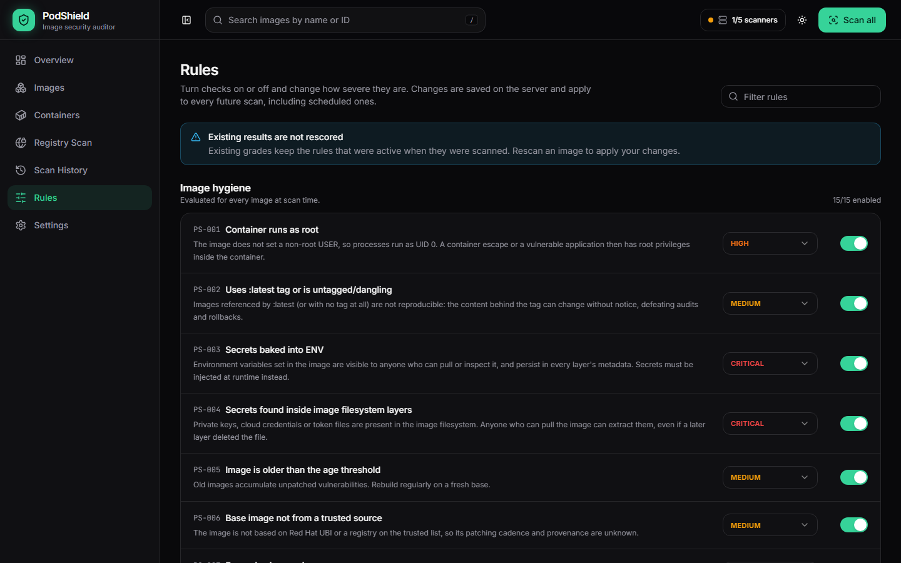
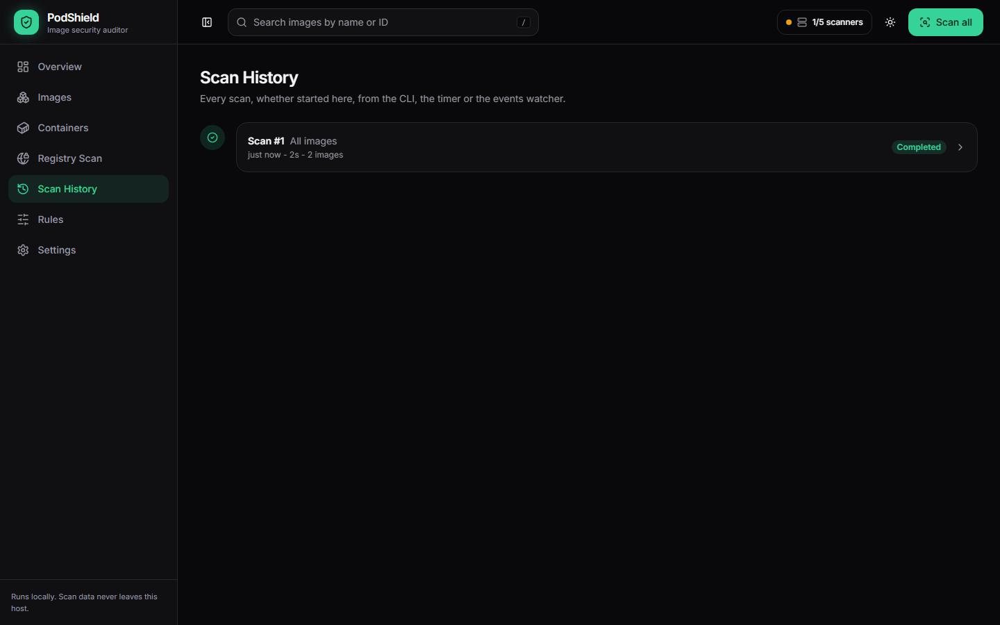

# PodShield

Security and hygiene auditor for **Podman** images and containers on **RHEL 9** (SELinux
enforcing, firewalld active). It scores every local image from 0 to 100, explains each finding
with the exact fix, and shows the results in a local dashboard, a CLI and HTML reports.

* Podman only. It talks to the Podman API socket; there is no Docker dependency.
* Runs on the host, keeps data on the host (SQLite). Nothing is sent anywhere.
* Works with whatever scanners are installed. A missing `oscap-podman`, `trivy` or `skopeo`
  disables only that feature and is reported by `podshield doctor`.
* Never logs secret values. Secrets found in an image are masked everywhere (first 4 characters
  plus `****`), in the database, the API, the UI and the reports.



## What it checks

**Images** (`podshield scan`)

| Rule | Severity | What it flags |
|------|----------|---------------|
| PS-001 | high | Image runs as root |
| PS-002 | medium | `:latest` tag, or untagged/dangling image |
| PS-003 | critical | Secrets baked into `ENV` |
| PS-004 | critical | Secrets inside the image filesystem (keys, cloud credentials, `.env`, tokens) |
| PS-005 | medium | Image older than the age threshold (default 90 days) |
| PS-006 | medium | Base image not UBI and not from a trusted registry |
| PS-007 | low | Excessive size (default over 1024 MB) |
| PS-008 | low | Too many layers (default over 30) |
| PS-009 | low | Package manager caches left in the image |
| PS-010 | medium | Setuid/setgid binaries |
| PS-011 | low | No `HEALTHCHECK` |
| PS-012 | info | Missing OCI labels (maintainer, version, source) |
| PS-013 | medium | Sensitive ports exposed (SSH, databases, Redis, ...) |
| PS-014 | medium | Unsigned image / registry not covered by a signature policy |
| PS-015 | info | Shell or package manager present in the final image |

CVEs come from `oscap-podman` with the Red Hat OVAL feed (RHEL/UBI images) and, if installed,
`trivy` (also covers non-RHEL ecosystems). Duplicates are merged and the sources are listed.

**Running containers** (`podshield containers`): PS-R01 privileged, PS-R02 SELinux labeling
disabled, PS-R03 host network/PID/IPC namespaces, PS-R04 sensitive host paths mounted, PS-R05
dangerous capabilities added.

**Remote images** (`podshield registry REF`): `skopeo inspect` audit before you pull.

**Score**: starts at 100. Critical costs 25, high 10, medium 4, low 1, info 0. CVE deductions
are capped at 40 so an old base image cannot hide everything else. Grades: A ≥ 90, B ≥ 80,
C ≥ 70, D ≥ 60, otherwise F. All weights are configurable.

## Requirements

* RHEL 9 (Rocky/Alma 9 work too), Podman 4.x or later, `systemd`
* Python 3.11 (`dnf install python3.11`)
* Optional: `openscap-utils` (provides `oscap-podman`), `skopeo`, `trivy`
* To build the dashboard: Node.js 20.19+ (Vite 7). `install.sh` installs it with
  `dnf module install nodejs:20` (falls back to `nodejs:22`). Not needed if `frontend/dist`
  already exists.

## Install

```bash
git clone <this repository> && cd podshield
sudo ./deploy/install.sh --dry-run     # shows every command, changes nothing
sudo ./deploy/install.sh
```

The installer is idempotent, so run it again to upgrade. It:

1. installs packages with `dnf` (Python 3.11, podman, skopeo, OpenSCAP);
2. creates a virtualenv in `/opt/podshield/venv` and installs the backend into it;
3. builds the dashboard if `frontend/dist` is missing (installing Node.js 20 with
   `dnf module install nodejs:20` first; RHEL's default Node is too old for Vite) and copies it
   to `/opt/podshield/frontend/dist`;
4. writes `/etc/podshield/config.toml` **only if it does not exist yet** (an updated example is
   always placed beside it as `config.toml.example`);
5. downloads and unpacks the Red Hat OVAL feed to `/var/lib/podshield/oval/rhel-9.oval.xml`
   (offline: `--oval-file PATH`; a failed download only warns);
6. runs `restorecon` on what it installed;
7. installs the systemd units and enables `podman.socket`, `podshield-api`, `podshield-watch`
   and `podshield-scan.timer`.

It never changes the SELinux mode or booleans. It opens a firewall port only when `--bind` is
not a loopback address. Flags: `--port N` (default 8080), `--bind ADDR` (default `127.0.0.1`),
`--oval-file PATH`, `--refresh-oval`, `--skip-oval`, `--skip-packages`, `--skip-frontend`,
`--skip-services`, `--no-timer`, `--no-watch`, `--skip-verify`, `--force` (other OS than RHEL 9). The port and
address are stored in `/etc/podshield/podshield.env`, which later runs keep unless you pass the
flags again.

Afterwards:

```bash
/opt/podshield/venv/bin/podshield doctor        # which scanners are available
/opt/podshield/venv/bin/podshield scan --all    # first scan
systemctl list-timers podshield-scan.timer      # next nightly scan
```

and open <http://127.0.0.1:8080> on the host (see "Exposing the dashboard" for remote access).

## RHEL Integration

PodShield runs as a native RHEL 9 service: no containers of its own, SELinux stays
**Enforcing**, and only RHEL tools are used (`dnf`, `systemd`, `journald`, `firewalld`,
`semanage`, `restorecon`).

| Path | Contents |
|------|----------|
| `/opt/podshield/` | the app: `venv/` (backend + CLI) and `frontend/dist/` (dashboard) |
| `/etc/podshield/config.toml` | configuration, never overwritten by the installer |
| `/etc/podshield/podshield.env` | listen address and port (`--bind`, `--port`) |
| `/var/lib/podshield/` | SQLite database, reports, `oval/rhel-9.oval.xml` |
| `/usr/local/bin/podshield` | symlink to the CLI |
| `/etc/systemd/system/podshield-*` | the four units below |

| Script | What it does |
|--------|--------------|
| `deploy/install.sh` | idempotent installer (details above). Ends by running `verify.sh` |
| `deploy/verify.sh` | read-only PASS/FAIL checks; exits 1 on any failure |
| `deploy/uninstall.sh` | removes units, app, firewall port and port label; keeps config and data unless `--purge` |
| `deploy/selftest.sh` | the whole chain in one command, see "Run the self-test" |
| `demo/run-demo.sh` | builds the bad and good demo images, waits for the watcher, prints both grades |

**systemd.** `podshield-api` (uvicorn) and `podshield-watch` are long-running
(`Restart=on-failure`). `podshield-scan.service` is a oneshot started daily by
`podshield-scan.timer` (`Persistent=true`, so a run missed while the VM was off happens after
boot). All three services `Requires=`/`After=podman.socket`, log to journald, and run as root,
because the rootful Podman socket, `podman image mount` and `oscap-podman` need it. The light
hardening is `PrivateTmp=true`, `ProtectHome=tmpfs` and `NoNewPrivileges=true`.

**SELinux.** The services run in the `unconfined_service_t` domain, which may bind any port, so
the installer adds a `semanage port` label (`http_port_t`) only if the service ever runs
confined. `NoNewPrivileges=true` blocks SELinux domain transitions the policy does not allow, so
the installer asks the loaded policy (`sesearch`, read-only) whether starting `podman`,
`skopeo` or `oscap-podman` from the service domain needs one. If it does, a drop-in
(`podshield-*.service.d/10-podshield-no-nnp.conf`) turns `NoNewPrivileges` off and the
installer says so. `restorecon -Rv` runs on the three directories. `setenforce` and `chcon` are
never used.

**firewalld.** The default `--bind 127.0.0.1` needs no firewall change. With any other address
the installer opens exactly `--port`/tcp, and `uninstall.sh` closes it again. The dashboard
has no login, so put an authenticating proxy in front before you expose it.

```bash
sudo bash deploy/verify.sh                 # PASS/FAIL report; exit 1 if anything failed
sudo bash deploy/uninstall.sh              # keep config + data
sudo bash deploy/uninstall.sh --purge      # remove everything PodShield created
```

## Run the self-test

One command on the RHEL 9 machine installs, verifies and exercises everything:

```bash
cd ~/PodShield && git pull && sudo bash podshield/deploy/selftest.sh --push-log
```

It never stops at the first failure. The steps are preflight (EL9, SELinux, disk, network),
`install.sh`, `verify.sh`, backend unit tests, root integration tests, the demo (watcher
auto-scan), an API smoke test against every endpoint, reboot safety (units enabled, restart
OK) and an SELinux AVC check. At the end it prints a one-screen summary with one
`[PASS]/[FAIL]/[SKIP]` line per step and a score:

```
=============================================================================
 PodShield self-test   2026-11-16 18:40   host workstation
 git 1a2b3c4   SELinux Enforcing   took 31m05s
-----------------------------------------------------------------------------
 [PASS] 1 Preflight             EL 9.5, Enforcing, 21304MB free, network ok
 [PASS] 2 Install (install.sh)  installed, 1 warning(s): trivy is not installed
 ...
 SCORE 9/9 steps passed (100%)   0 failed   0 skipped
```

The full log goes to `~/podshield-selftest-<timestamp>.log`. With `--push-log` the log, with
anything that looks like a credential masked, is committed to the `selftest-logs` branch and
pushed, so it can be read elsewhere with
`git fetch origin selftest-logs && git show origin/selftest-logs:logs/<file>`. The push never
prompts: if no GitHub credentials are saved it is skipped (the summary says so) and the log
stays local. To save a token once (as your normal user, not with sudo):

```bash
git config --global credential.helper store
read -rp 'GitHub user: ' u; read -rsp 'GitHub token: ' t; echo
printf 'url=https://github.com\nusername=%s\npassword=%s\n\n' "$u" "$t" | git credential approve
```

Other options:
`--skip-install`, `--skip-integration` (the slowest step), `--skip-demo`, and `--oval-file`,
`--port` and `--bind`, which are passed on to `install.sh`.

### OVAL feed for CVE scanning

The installer fetches the feed once. PodShield itself never downloads anything, so refresh it
with `install.sh --refresh-oval` or by hand (or from cron):

```bash
sudo curl -fL https://security.access.redhat.com/data/oval/v2/RHEL9/rhel-9.oval.xml.bz2 \
  | bzip2 -d | sudo tee /var/lib/podshield/oval/rhel-9.oval.xml >/dev/null
```

Without it, or without `oscap-podman`, the CVE section says "scanner unavailable" and the rest
of the scan runs normally.

### Manual install (no installer)

```bash
python3.11 -m venv /opt/podshield/venv
/opt/podshield/venv/bin/pip install ./backend
(cd frontend && npm ci && npm run build)
sudo cp deploy/config.toml.example /etc/podshield/config.toml
sudo install -m 0644 deploy/systemd/podshield-* /etc/systemd/system/
sudo systemctl daemon-reload
sudo systemctl enable --now podman.socket podshield-api podshield-watch podshield-scan.timer
```

## Services

| Unit | Purpose |
|------|---------|
| `podshield-api.service` | Dashboard and REST API (uvicorn, **one worker**, `127.0.0.1:8080`) |
| `podshield-watch.service` | Scans an image shortly after Podman reports a pull, build, tag, import or load |
| `podshield-scan.service` + `.timer` | Nightly `podshield scan --all` at about 02:30 (`Persistent=true`, so a missed run happens after boot) |

Logs are structured JSON on stdout, collected by journald:

```bash
journalctl -u podshield-api -u podshield-watch -u podshield-scan -f
```

Change the bind address or port by re-running the installer (`sudo ./deploy/install.sh --port
9000`), or edit `/etc/podshield/podshield.env` and `systemctl restart podshield-api`. A
`systemctl edit` drop-in with `Environment=` does not work for these two: values from the
`EnvironmentFile` win.

The API runs one worker on purpose: scan progress and the scan queue live in that process.
Scans started by the CLI, the timer or the watcher write to the same database and show up in
**Scan History**. A scan whose process dies (no heartbeat for 45 seconds) is marked as failed by
the API, which checks every 20 seconds while it runs.

## Configuration

`/etc/podshield/config.toml`; every key is optional and [`deploy/config.toml.example`](deploy/config.toml.example)
lists all of them with their defaults. Precedence: environment variable, config file, default.

| Variable | Overrides |
|----------|-----------|
| `PODSHIELD_CONFIG` | path of the TOML file |
| `PODSHIELD_PODMAN_SOCKET` | `[podman] socket` |
| `PODSHIELD_DB_PATH` | `[database] path` |
| `PODSHIELD_LOG_LEVEL` | `[logging] level` |
| `PODSHIELD_STATIC_DIR` | `[server] static_dir` |
| `PODSHIELD_MAX_IMAGE_AGE_DAYS` | `[thresholds] max_image_age_days` |

Rules can be disabled or re-rated in the **Rules** page or in the file (`[rules.PS-007]
enabled = false`). A change made in the dashboard is stored in the database and wins over the
file; it also applies to the nightly scan and the watcher.

Put your internal registry under `[trust] trusted_registries` so PS-006 stops flagging it.

## Command line

```bash
podshield scan IMAGE            # name, tag or ID
podshield scan --all            # every local image
podshield scan --all --json     # machine-readable
podshield scan --all --fail-on high -v    # CI gate, with remediation snippets
podshield report [IMAGE]        # latest stored results, no scanning
podshield containers            # audit running containers
podshield registry quay.io/podman/hello:latest   # audit before pulling
podshield doctor                # scanner availability
podshield watch                 # run the events watcher in the foreground
```

Exit codes: `0` success, `1` findings at or above `--fail-on`, `2` error, `130` interrupted.
Useful `scan` flags: `--skip-filesystem` (do not mount images), `--skip-cve`.

### Watcher

`podshield watch` listens to `podman events`. A pull emits several events, so it waits
`debounce_seconds` (default 5) after the last event for an image and then scans it once. If the
socket drops it reconnects with backoff and resumes from the last event it saw. A failing scan
is logged and never stops the watcher. PodShield's own `podman save` and image mounts are not
in the trigger list, so scans cannot trigger scans.

## Dashboard and API



Pages: Overview, Images (sortable table, detail with findings, CVEs, layers and config),
Containers, Registry Scan, Scan History, Rules, Settings. **Scan all** and **Rescan** show live
progress. Each image has a **Download report** button: a single self-contained HTML file with
no external assets, safe to attach to a ticket.

| Method and path | Purpose |
|-----------------|---------|
| `GET /api/overview` | fleet score, grade distribution, trend |
| `GET /api/images`, `GET /api/images/{id}` | summaries, full detail |
| `GET /api/reports/{ref}.html` | downloadable report |
| `POST /api/scans`, `GET /api/scans`, `GET /api/scans/{id}` | start (202) and inspect scans |
| `GET /api/scans/{id}/stream` | Server-Sent Events progress |
| `GET /api/containers` | runtime audit |
| `POST /api/registry/inspect` | pre-pull audit |
| `GET /api/rules`, `PATCH /api/rules/{id}` | list, enable/disable, re-rate |
| `GET /api/health` | status and scanner availability |

Interactive API docs are served at `/api/docs`.

### Exposing the dashboard

**There is no login.** That is why the service binds to `127.0.0.1`. To reach it from another
machine, do not just open the port; put a reverse proxy that authenticates users in front:

```bash
# nginx (or Apache httpd) proxying to 127.0.0.1:8080, with TLS and authentication
sudo setsebool -P httpd_can_network_connect 1     # lets the web server proxy; standard boolean
sudo firewall-cmd --permanent --add-service=https
sudo firewall-cmd --reload
```

For quick access from your own workstation, an SSH tunnel is enough:
`ssh -L 8080:127.0.0.1:8080 user@host`, then open <http://127.0.0.1:8080>.

Also remember that the dashboard can start scans, which mount images and take CPU and disk, and
that it runs as root to reach the rootful Podman socket.

## Demo images

Two small images show the contrast. Build with `--format docker`; the default OCI format drops
`HEALTHCHECK`.

```bash
sudo podman build --format docker -t localhost/demo-bad:latest -f demo/Containerfile.bad  demo/
sudo podman build --format docker -t localhost/demo-good:1.0.0 -f demo/Containerfile.good demo/
sudo podshield scan --all -v
```

`demo-bad` is deliberately awful (root, secrets in `ENV` and in the filesystem, setuid shell,
SSH port, no healthcheck). All its credentials are fake. `demo-good` is the same web server
built to pass the hygiene rules (UBI, non-root, labels, healthcheck, clean caches).

## Screenshots

The screenshots in this repository come from `backend/scripts/demo_server.py`, which runs the
real app against fake data, so you can preview the UI without Podman:

```bash
cd backend && python scripts/demo_server.py      # http://127.0.0.1:8765
```

| | |
|---|---|
|  |  |
|  |  |
|  | |

## SELinux and firewalld

PodShield works with SELinux enforcing and does not need it relaxed. Do **not** disable SELinux
or put it in permissive mode to "fix" a problem; use the steps below to find the real cause.

* The installer places everything in the default-labelled locations `/opt/podshield`,
  `/etc/podshield`, `/var/lib/podshield` and `/etc/systemd/system`, and runs `restorecon`.
* Nothing needs a firewall port by default: the dashboard listens on loopback and PodShield makes no
  inbound or (apart from optional Trivy DB updates and `skopeo`) outbound connections.

## Troubleshooting

**`podshield doctor` or a scan says Podman is unavailable / permission denied on the socket**

```bash
systemctl status podman.socket
ls -l /run/podman/podman.sock
```

* The rootful socket belongs to root, so run the CLI with `sudo`, or let the services (which run
  as root) do the work. Do not `chmod 666` the socket: that gives every local user root.
* Not running? `sudo systemctl enable --now podman.socket`.
* Rootless instead: `systemctl --user enable --now podman.socket`, then set
  `socket = "unix:///run/user/1000/podman/podman.sock"` and `mode = "rootless"` under `[podman]`
  (or `PODSHIELD_PODMAN_SOCKET`). Images are then inspected through `podman unshare`.

**SELinux denials (AVCs)**

```bash
sudo ausearch -m AVC,USER_AVC -ts recent
sudo journalctl -t setroubleshoot --since "1 hour ago"
sudo sealert -a /var/log/audit/audit.log        # needs setroubleshoot-server
```

1. *Wrong file labels* are the usual cause, for example the install directory was copied from
   `/home` or `/tmp` (`user_home_t`, `user_tmp_t`), and systemd is denied `execute`:
   `sudo restorecon -Rv /opt/podshield /etc/podshield /var/lib/podshield /etc/systemd/system`.
2. Denials for `container_t` or `spc_t` come from your containers, not from PodShield; fix the
   container (for example add `:Z` to a bind mount, or do not use `--security-opt label=disable`,
   which PS-R02 flags).
3. If a denial remains for PodShield itself, report it; as a last resort build a narrow local
   module from the *reviewed* denial instead of loosening the system:
   `sudo ausearch -m AVC -c uvicorn --raw | audit2allow -M podshield_local`, read the generated
   `podshield_local.te`, then `sudo semodule -i podshield_local.pp`.

**Filesystem findings are missing (PS-004, PS-009, PS-010, PS-015) and a warning mentions mount**

Those rules need `podman image mount` (root) or `podman unshare` (rootless). Check
`doctor`, run `sudo podman image mount <image>` by hand and read the error, and look for AVCs as
above. Scans still complete without them; `--skip-filesystem` makes that explicit.
PodShield always unmounts, even on errors. If a crash left mounts behind, run
`sudo podman image unmount --all`.

**No CVEs reported**

* `doctor` shows `oscap-podman` or `trivy` as UNAVAILABLE: install them (see Requirements).
* oscap needs the OVAL file at `[oscap] oval_path`; see "OVAL feed" above.
* Trivy needs to download its database on first use; in an offline lab pre-seed the cache and
  set `skip_db_update = true`. If `/tmp` is a small tmpfs, set `[trivy] tmp_dir` to a real
  directory, since `podman save` writes a tarball there.

**Dashboard unreachable**

* `journalctl -u podshield-api -e`; look for "address already in use" (change `PODSHIELD_PORT`)
  or a missing `/opt/podshield/frontend/dist` (the API still works, `curl localhost:8080/api/health`;
  rebuild the frontend and re-run the installer).
* From another host it is unreachable by design; see "Exposing the dashboard".

**The watcher does not scan anything**

`journalctl -u podshield-watch -f` then `sudo podman pull registry.access.redhat.com/ubi9/ubi-micro`.
You should see "image event" and, after the debounce, "watcher scan starting". If the log keeps
printing "podman event stream failed, retrying", the socket is unreachable (see the first item).

**A scan shows as "failed: interrupted"**

The process running it (API, CLI, timer or watcher) stopped before finishing, for example a
restart or a reboot during a scan. Just run it again.

**`database is locked`**

The API, the watcher and the timer share one SQLite file in WAL mode and wait up to 30 seconds
for a lock, so brief contention is normal. If it persists, check that `/var/lib/podshield` is on a local disk
(not NFS) and that only one `podshield-api` instance runs.

## Development

```bash
cd backend
python3.11 -m venv .venv && . .venv/bin/activate
pip install -e '.[dev]'
pytest                      # unit tests; no Podman, oscap or trivy needed (they are mocked)
mypy podshield              # strict
ruff check podshield tests

cd ../frontend
npm ci
npm run dev                 # http://localhost:5173, proxies /api to 127.0.0.1:8000
npm test
npm run build               # produces frontend/dist, served by the API
```

Run the API without systemd:

```bash
cd backend
PODSHIELD_DB_PATH=/tmp/podshield.db PODSHIELD_STATIC_DIR=../frontend/dist \
  uvicorn --factory podshield.main:create_default_app --port 8000
```

Layout:

```
backend/podshield/      cli, api, watcher, orchestrator, scanners/ (rules, secrets, oscap, trivy, ...)
backend/tests/          mocked unit tests, including static checks of deploy/
frontend/               React + Vite + Tailwind dashboard (built to static files, no CDN)
deploy/                 install.sh, config.toml.example, systemd/ units
demo/                   Containerfile.bad and Containerfile.good
```

## Limitations

* No authentication; see "Exposing the dashboard".
* One API worker (in-memory scan queue and progress stream).
* The systemd units, `install.sh` and the Podman events stream are verified by static checks and
  mocks in CI, not by a test run on a real RHEL 9 host. Run `install.sh --dry-run` first and
  check `journalctl` after the first start.
* Rule-based and CVE-feed-based: a clean report is not proof that an image is safe.
